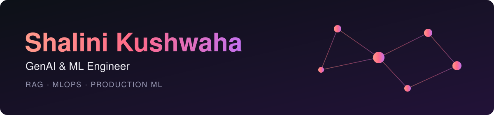

 

Delhi, India &nbsp;·&nbsp; Open to AI/ML, GenAI and Data Science fresher roles

 

  

 

## ✦ About

I build AI that keeps working after the demo.

By day I validate 2,000+ video labels at Amazon at 99.6% accuracy, so I've seen first-hand what bad data does to a model. By night I build RAG chatbots, fraud detection with agents, and drift monitoring that catches models going stale.

Looking for my first AI/ML role where I can ship real things..

 

## ✦ Featured Projects

<table>
<tr>
<td width="50%" valign="top">

#### RAG Document Chatbot
Chat with your own documents. PDF text goes into ChromaDB, and answers are grounded in the retrieved context so they stay on topic.

- Multi-user login with saved chat threads
- Modular pipeline: ingest → embed → retrieve → generate
- Easy to swap LLM backends

[View repo →](https://github.com/itsshaliniS/Rag_chat_bot)

</td>
<td width="50%" valign="top">

#### Fraud Detection with MCP Agents
End-to-end fraud platform on 468K transactions, with feature engineering in pure SQL and a 3-agent review workflow.

- 0.3028 PR-AUC on 140K unseen transactions
- MCP server with drift monitoring (PSI)
- Docker, GitHub Actions CI, 11/11 tests passing

[View repo →](https://github.com/itsshaliniS/YOUR-FRAUD-REPO)

</td>
</tr>
<tr>
<td width="50%" valign="top">

#### Drift Guard
MLOps platform that watches deployed models for data drift and decay in real time, with a live dashboard.

- Three drift tests: KS, PSI, Jensen-Shannon
- Synthetic drift simulator to validate detection
- FastAPI backend + Chart.js dashboard

[View repo →](https://github.com/itsshaliniS/DriftGuard)

</td>
<td width="50%" valign="top">

#### More work
- [Melanoma Detection](https://github.com/itsshaliniS/Melanoma-Detection-Assignment): CNN for skin cancer classification
- [House Price Prediction](https://github.com/itsshaliniS/Surprise-Housing): Ridge and Lasso regression
- [Bike Sharing Demand](https://github.com/itsshaliniS/Bike-sharing): demand forecasting
- [YouTube Trend Analysis](https://github.com/itsshaliniS/Youtube_Analysis): EDA and visualization

</td>
</tr>
</table>

 

## ✦ Skills

**Gen AI** 

**Machine Learning** 

**Backend & Tools** 

 

## ✦ Experience & Education

- **ML Data Associate, Amazon** (Jun 2024 – Present): validating production ML annotations at 99.6% accuracy, tracking defect trends in QuickSight
- **MCA**, GGSIPU (BCIIT), 2024 – 2026
- **B.Sc. Physical Sciences (CS)**, Deshbandhu College, University of Delhi
- **Advanced Certificate in ML & Deep Learning**, IIIT Bangalore
- **AWS:** Essentials of Prompt Engineering, Developing GenAI Solutions

 

**Let's talk:** [LinkedIn](https://www.linkedin.com/in/shalinikush) · [shalini2012.delhi@gmail.com](mailto:shalini2012.delhi@gmail.com)

